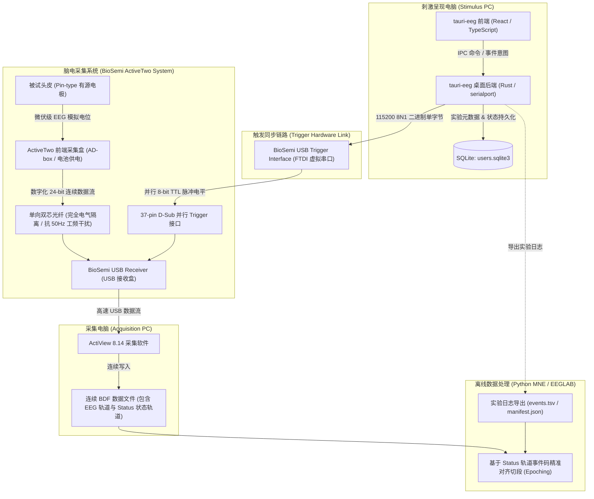
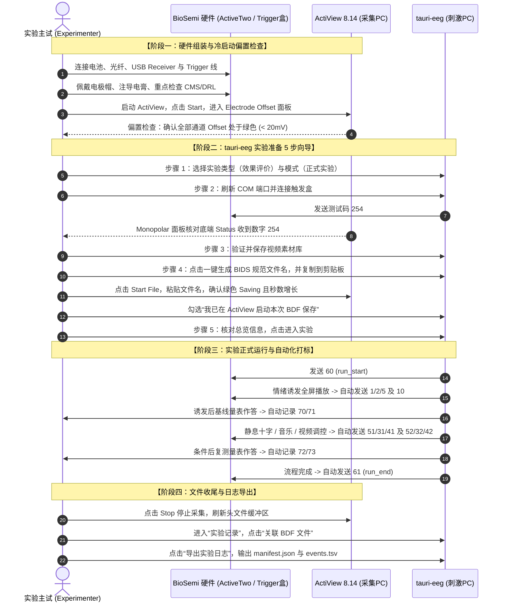
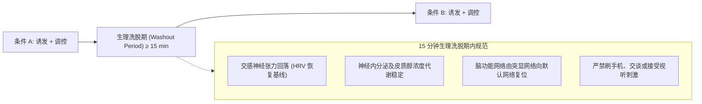
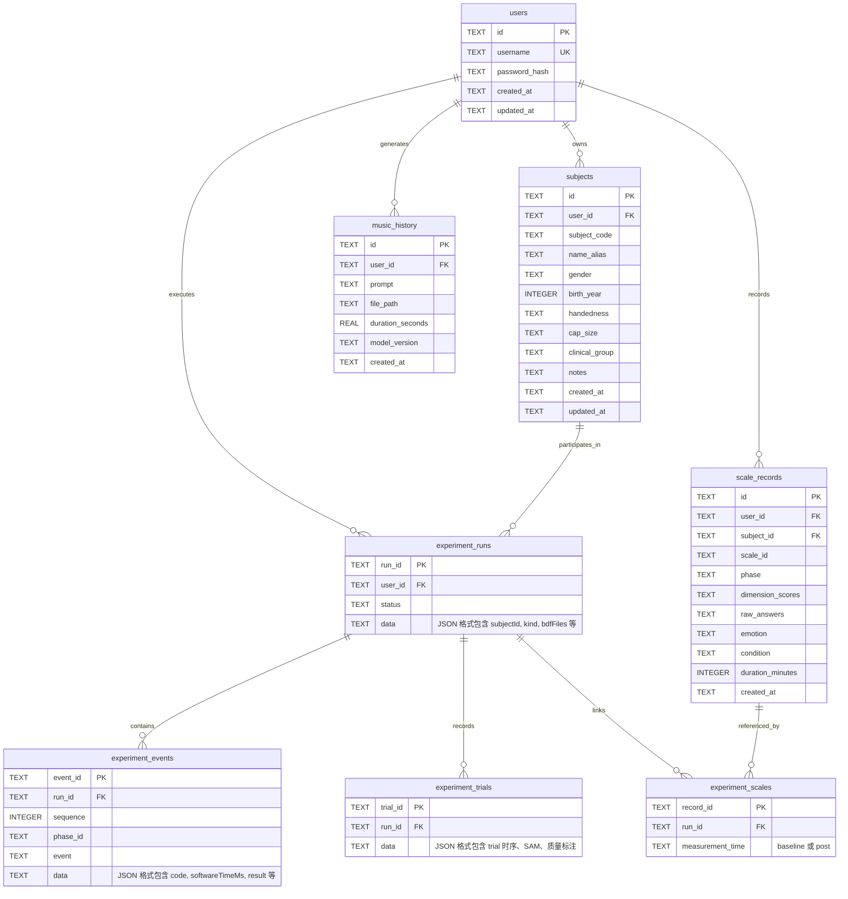

# tauri-eeg: 脑机接口与多模态情绪调控实验系统

> 一款专为认知神经科学与脑机接口（BCI）实验设计的科研级桌面系统。基于 **Tauri 2 + React + Rust** 构建，集成了多模态情绪诱发（标准化视频库）、音乐与视频调控、心理量表自动化评估、**BioSemi ActiveTwo 硬件级微秒同步打标** 以及符合 **BIDS (Brain Imaging Data Structure)** 规范的实验数据管线。

---

## 目录

- [1. 系统架构与硬件协同打标原理](#1-系统架构与硬件协同打标原理)
  - [1.1 物理拓扑架构（双机协同）](#11-物理拓扑架构双机协同)
  - [1.2 串口通信与 8ms 硬件脉冲锁存机制](#12-串口通信与-8ms-硬件脉冲锁存机制)
  - [1.3 BDF Status 通道低 8 位映射与 12ms 保护间隔](#13-bdf-status-通道低-8-位映射与-12ms-保护间隔)
  - [1.4 离线分析读取：Python MNE 读取规范与事件对齐](#14-离线分析读取python-mne-读取规范与事件对齐)
  - [1.5 实验事件编码表（biosemi_events_v1）](#15-实验事件编码表biosemi_events_v1)
- [2. 端到端实验标准操作规程（SOP）](#2-端到端实验标准操作规程sop)
  - [阶段一：硬件组装、电极佩戴与 ActiView 冷启动偏置检查](#阶段一硬件组装电极佩戴与-actiview-冷启动偏置检查)
  - [阶段二：tauri-eeg 实验准备 5 步向导](#阶段二tauri-eeg-实验准备-5-步向导)
  - [阶段三：实验正式运行与自动化打标](#阶段三实验正式运行与自动化打标)
  - [阶段四：ActiView 停止保存、BDF 文件关联与实验日志导出](#阶段四actiview-停止保存bdf-文件关联与实验日志导出)
- [3. 静息·诱发·调控实验注意事项与电生理规范](#3-静息诱发调控实验注意事项与电生理规范)
  - [3.1 静息期中央注视十字与 Alpha 节律保护（消除 CNV 预期电位）](#31-静息期中央注视十字与-alpha-节律保护消除-cnv-预期电位)
  - [3.2 诱发后急性情绪时间窗口与认知反刍抑制](#32-诱发后急性情绪时间窗口与认知反刍抑制)
  - [3.3 跨条件测试的 15 分钟生理洗脱期（Washout Period）](#33-跨条件测试的-15-分钟生理洗脱期washout-period)
  - [3.4 实验室物理声光环境与伪迹控制规范](#34-实验室物理声光环境与伪迹控制规范)
- [4. 数据存储结构与 BDF 关联机制](#4-数据存储结构与-bdf-关联机制)
  - [4.1 SQLite 数据库表设计全景](#41-sqlite-数据库表设计全景)
  - [4.2 原始 BDF 存储拓扑与系统解耦关联机制](#42-原始-bdf-存储拓扑与系统解耦关联机制)
  - [4.3 导出实验日志工件清单](#43-导出实验日志工件清单)
- [5. 快速开始与环境搭建](#5-快速开始与环境搭建)
  - [5.1 开发环境依赖要求](#51-开发环境依赖要求)
  - [5.2 前端安装与启动（统一 pnpm）](#52-前端安装与启动统一-pnpm)
  - [5.3 音乐生成服务配置（可选）](#53-音乐生成服务配置可选)
  - [5.4 实验视频素材库准备规范](#54-实验视频素材库准备规范)
- [6. 构建、测试与验证](#6-构建测试与验证)
- [7. 常见故障排查（Troubleshooting）](#7-常见故障排查troubleshooting)

---

## 1. 系统架构与硬件协同打标原理

本系统采用刺激呈现与脑电采集**物理隔离、时间同步**的经典认知神经科学双机协同实验架构：`tauri-eeg` 运行于刺激呈现电脑（Stimulus PC），通过微秒级硬件串口触发盒向脑电采集系统发送事件码（Triggers）；`ActiView 8.14` 运行于采集电脑（Acquisition PC），负责全通道原始脑电与 Trigger 信号的连续记录并保存为 `.bdf` 格式文件。



### 1.1 物理拓扑架构（双机协同）

1. **刺激电脑 (Stimulus PC)**：运行 `tauri-eeg` 应用，负责高精度音视频播放、实验交互、SAM 及心理量表测量。电脑 USB 接口接入 **BioSemi USB Trigger Interface** 线缆（在 Windows 设备管理器中识别为 COM 串口，如 `COM5`）。
2. **触发转接线缆 (USB Trigger Interface)**：内置 FTDI 芯片与脉冲发生电路，将 PC 串口送入的二进制单字节转换为 **8 位并行 TTL 电平信号**，末端为 37 针 D-Sub 并行接口公头。
3. **USB 接收盒 (BioSemi USB Receiver)**：触发线缆的 37 针插头插入 USB Receiver 背部的 Trigger 接口；Receiver 通过专用 USB 线连接采集电脑。
4. **前端放大器 (ActiveTwo AD-box)**：由专用恒流充电电池供电，放置于被试身旁。脑电电极帽直接接入 AD-box。AD-box 与 USB Receiver 之间通过**双芯光纤 (Optic Fiber)** 单向传输数字化脑电信号，提供完整的物理绝缘与电气隔离，不仅彻底杜绝漏电安全隐患，而且完全切断接地环路（Ground Loop）对脑电信号的 50 Hz 工频电磁串扰。
5. **采集电脑 (Acquisition PC)**：运行 `ActiView 8.14`，负责接收光纤与 Trigger 的合成数据流，实时显示波形并将数据写入 BDF 文件。

### 1.2 串口通信与 8ms 硬件脉冲锁存机制

`tauri-eeg` 的 Rust 核心通过专用单线程工作器（Worker Thread）持有串口资源，遵循 BioSemi 官方协议规范：
- **波特率 (Baud Rate)**：`115200 bps`
- **数据位 (Data Bits)**：`8 bits`
- **停止位 (Stop Bits)**：`1 bit`
- **奇偶校验 (Parity)**：无校验 (`None`)
- **流控 (Flow Control)**：无流控 (`None`)

当呈现系统发生关键事件（如视频第一帧渲染渲染、量表提交、静息开始）时，Rust 核心直接向 COM 串口写入一个**单字节二进制数** `[code]`（值域：$1 \sim 255$）。
> [!NOTE] 
> 严禁向 Trigger 串口发送 ASCII 格式字符串（如 `"60\r\n"`）或 JSON 数据，否则硬件会将每个字符的 ASCII 码误判为连续的高频事件脉冲。

**硬件脉冲锁存机制**：
BioSemi USB Trigger Interface 在接收到串口写入的单字节后，硬件自动拉高对应引脚的电平，产生一个持续时间约为 **8 ms** 的高电平脉冲，随后硬件芯片内部定时器超时并**自动归零**（复位为低电平 `0`）。软件层无需（且不应）手动额外发送 `0`。

### 1.3 BDF Status 通道低 8 位映射与 12ms 保护间隔

1. **Status 通道映射机制**：
   ActiveTwo 接收盒将 37 针并行口的引脚电平与光纤传输的脑电数据帧严格按采样点进行硬件级锁存。写入 BDF 文件的 `Status` 轨道是一个 24 位的复合通道：
   - **低 8 位 (`Bit 0 ~ Bit 7`)**：严格对应 USB Trigger Interface 的 8 位并行输入（数值范围 $0 \sim 255$）。
   - **高 16 位 (`Bit 8 ~ Bit 23`)**：保留用于 CMS 锁定指示、光电传感器输入、网络同步字或 ActiView 状态标记。
2. **12ms 间隔保护窗 (Interval Guard)**：
   由于硬件脉冲宽度默认为 8 ms，若软件在 8 ms 内连续下发两个 Trigger，硬件端的高电平尚未降回低电平，后一个 Trigger 将与前一个 Trigger 粘连合并，导致严重的漏标或码值叠加错乱。
   `tauri-eeg` 后端施加了 **$\ge 12\text{ ms}$ 的最小安全调度间隔**：
   $$\Delta t_{\text{interval}} \ge 12\text{ ms} > 8\text{ ms (Pulse Width)}$$
   确保两个相邻 Trigger 之间拥有至少 $4\text{ ms}$ 的稳定零电平静默期，彻底杜绝硬件粘包。

### 1.4 离线分析读取：Python MNE 读取规范与事件对齐

在进行离线 ERP / 时频分析时，必须使用位掩码提取 `Status` 通道的低 8 位。如果直接提取无掩码的 `Status` 通道数值，高位状态位变动会产生大于 255 的错误伪码（如 65280, 16776960）。

#### 标准 Python (MNE-Python) 读取代码范例

```python
import mne
import numpy as np
import pandas as pd

# 1. 载入原始 BDF 文件
bdf_file = "sub-001_ses-01_task-effect.bdf"
raw = mne.io.read_raw_bdf(bdf_file, preload=True)

# 2. 提取事件矩阵：必须指定 mask=0x0000FF 屏蔽高 16 位！
# BioSemi Status 轨道的低 8 位对应 0x0000FF (十进制 255)
events = mne.find_events(
    raw,
    stim_channel="Status",
    mask=0x0000FF,  # 仅保留 Bit 0 - Bit 7
    mask_type="and",
    shortest_event=1,  # 确保 8ms 脉冲在 2048Hz 下被完整捕获 (约 16 个采样点)
    consecutive=False,
)

print(f"提取到有效事件总数: {len(events)}")
print(f"事件码种类: {np.unique(events[:, 2])}")

# 3. 与 tauri-eeg 导出的 events.tsv 进行严格时序交叉校验
events_tsv = "events.tsv"
df_software = pd.read_csv(events_tsv, sep="\t")

print("\n--- 硬件 BDF 与软件日志前 5 个事件比对 ---")
for i in range(min(5, len(events))):
    bdf_sample = events[i, 0]
    bdf_code = events[i, 2]
    soft_seq = df_software.iloc[i]["sequence"]
    soft_code = df_software.iloc[i]["code"]
    soft_name = df_software.iloc[i]["event"]
    print(
        f"[{i+1}] BDF采样点: {bdf_sample} | 硬件码: {bdf_code} <---> 软件序: {soft_seq} | 软件码: {soft_code} ({soft_name})"
    )
    assert (
        bdf_code == soft_code
    ), f"事件码不匹配: BDF={bdf_code} vs Software={soft_code}"
```

### 1.5 实验事件编码表（biosemi_events_v1）

系统采用版本化的冻结事件表 `biosemi_events_v1`，非零单字节码表示对应实验时点：

| 事件编码 (十进制) | 符号标识 (`event`) | 触发时点与生理/范式意义 |
|:---:|:---|:---|
| **1** | `depression_video_start` | 抑郁诱发视频第一帧有效渲染 |
| **2** | `anxiety_video_start` | 焦虑诱发视频第一帧有效渲染 |
| **3** | `calm_video_start` | 平静校准视频第一帧有效渲染 |
| **5** | `fear_video_start` | 恐惧诱发视频第一帧有效渲染 |
| **10** | `induction_video_end` | 情绪诱发视频播放结束 |
| **20** | `baseline_rest_start` | 逐试次实验静息基线开始（5 秒） |
| **21** | `hint_start` | 逐试次试前提示呈现（2 秒） |
| **22** | `post_rest_start` | 逐试次试后静息开始（5 秒） |
| **31** | `music_regulation_start` | 音乐调控首帧出声（启动调控窗口计时） |
| **32** | `music_regulation_end` | 音乐调控窗口到达预设时长结束 |
| **41** | `video_regulation_start` | 视频调控第一帧有效渲染（启动调控窗口计时） |
| **42** | `video_regulation_end` | 视频调控窗口到达预设时长结束 |
| **51** | `natural_recovery_start` | 自然恢复静息注视十字呈现（启动计时） |
| **52** | `natural_recovery_end` | 自然恢复静息窗口到达预设时长结束 |
| **60** | `run_start` | 正式实验运行开始（初始化） |
| **61** | `run_end` | 正式实验运行正常闭环完成 |
| **70** | `pre_scale_start` | 诱发后基线量表（STAI-S/PANAS）页面挂载 |
| **71** | `pre_scale_submit` | 诱发后基线量表作答完成并提交保存 |
| **72** | `post_scale_start` | 调控后量表页面挂载 |
| **73** | `post_scale_submit` | 调控后量表作答完成并提交保存 |
| **74** | `sam_start` | SAM 情感自评窗挂载 |
| **75** | `sam_submit` | SAM 评分完成并提交 |
| **80** | `media_pause` | 媒体非预期暂停（记录异常时标） |
| **81** | `media_resume` | 媒体从暂停恢复播放 |
| **90** | `playback_error` | 媒体解码或呈现故障 |
| **91** | `run_abort` | 主试主动中止运行 |
| **93 / 94** | `trial_start` / `trial_end` | 独立试次整体起止边界 |
| **254** | `trigger_test` | 硬件连接链路连通性与入标测试码 |

---

## 2. 端到端实验标准操作规程（SOP）

本 SOP 专为主试（Experimenter）设计，涵盖从硬件组装到数据导出的全生命周期操作。



### 阶段一：硬件组装、电极佩戴与 ActiView 冷启动偏置检查

1. **环境准备**：
   - 确保实验室内电磁环境稳定，关闭手机、大功率射频发射设备，调暗环境光至舒适弱光状态，室温维持在 22–24℃。
2. **硬件物理组装**：
   - 检查 ActiveTwo 充电电池组，确认指示灯显示满电（绿灯），插入 AD-box 电池卡槽。
   - 插入光纤：将双芯光纤一端插入 AD-box，另一端插入 USB Receiver（**严禁弯折光纤，弯曲半径必须 $\ge 5\text{ cm}$**）。
   - 连接 USB 线缆：USB Receiver 连接采集 PC；USB Trigger Interface 的 37 针公头锁定在 Receiver 的 Trigger 接口，USB 端接入刺激 PC。
3. **电极帽佩戴与注胶规范**：
   - 使用卷尺测量被试头围（如 54cm、56cm、58cm），选用适配尺寸的 BioSemi 专用电极帽。
   - 定位标定：以鼻根（Nasion）与枕外隆凸（Inion）连线的中点（50%）精准定位 **Cz** 电极孔，确保电极帽对称佩戴，无偏斜。系紧下颌带。
   - 注射导电膏：使用钝头平针注射器抽取 Signa Gel 或 BioSemi 专用导电膏。将电极按颜色和标号稳妥旋入电极座。注胶时轻拨电极孔内发丝，注入适量导电膏桥接头皮与电极传感器，注意避免导电膏溢出造成相邻电极短路。
   - **核心关键：CMS 与 DRL 电极优化**：
     > [!IMPORTANT]
     > BioSemi ActiveTwo 采用独有的 **CMS (Common Mode Sense) / DRL (Driven Right Leg)** 负反馈参考系统替代传统接地回路。
     > 如果 CMS 或 DRL 电极接触不良，整套系统的共模抑制比（CMRR）将失效，导致所有通道全部饱和。因此，**必须首先对 CMS 与 DRL 电极孔进行彻底注胶与轻柔打圈按摩**，确保二者接触良好！
4. **ActiView 冷启动与直流偏置（Offset）检验**：
   - 打开 AD-box 电源开关。采集 PC 上启动 `ActiView 8.14`，点击左上角 **`Start`** 启动数据流。
   - 确认右侧仪表盘 **`Sample Rate [Hz]`** 稳定显示目标采样率（如 2048 Hz）。
   - 观察右上角 **`CM in Range`** 指示灯必须呈现常绿状态。
   - 切换至 **`Electrode Offset`** 面板：
     - BioSemi 有源电极不测量交流阻抗（Impedance），而是直接测量每个电极相对于零电位回路的直流偏置电压（DC Offset）。
     - **合格判定标准**：所有使用通道的 Offset 柱状图绝对值必须处于 **$< 20\text{ mV}$（全绿色安全区间）**。
     - 若出现蓝色（20–50 mV），应补注少量导电膏并轻转电极；若出现红色超量程（$> 50\text{ mV}$），说明电极严重虚接或浮空，必须重新处理直至转绿。

### 阶段二：tauri-eeg 实验准备 5 步向导

在刺激 PC 打开 `tauri-eeg`，登录主试账号，点击侧边栏 **【实验设置】**：

1. **第 1 步：选择实验**
   - 实验流程选择：选择 **【效果评价】**（用于诱发-前测-调控-后测全流程）或 **【逐试次范式】**（用于单试次基线校准/独立诱发）。
   - 实验模式选择：必须选择 **【正式实验 · 发送 Trigger】**（只有此模式才会真实向串口下发事件码；排练模式仅写本地日志）。
2. **第 2 步：连接与测试**
   - 点击 **【刷新端口】**，在下拉菜单选择 USB Trigger 对应的端口（如 `COM5`）。
   - 点击 **【连接触发盒】**，界面状态更新为 `触发盒 已连接 · COM5`。
   - **发送测试 Trigger**：点击按钮向串口发送测试码 `254`。
   - **ActiView 端核对**：切换到 ActiView 的 `Monopolar` 面板，将底端触发信号显示切换为 `Digital` / `Decimal`，目视核对 `Trig 1-8` 是否准确跳出数字 **`254`**。核对无误后继续。
3. **第 3 步：准备素材**
   - 点击 **【选择文件夹】** 选择根目录下的 `video_paradigm` 文件夹。
   - 点击 **【验证并保存素材库】**，系统将自动校验 Anxiety、Depression、Fear、Calm 各子目录下的 MP4 文件时长是否在 45–90 秒范围内。
4. **第 4 步：保存脑电（BIDS 规范命名一键复制）**
   - 切换到 ActiView 软件，在右侧 `Save Subset` 勾选保存通道（如 `A1-B32` 64 通道）。
   - 回到 tauri-eeg，点击 **【基于当前被试生成规范 BDF 命名】**，系统将自动拼接生成符合脑成像国际规范的文件名：
     $$\text{sub-}<SubjectID>\_\text{ses-}<Session>\_\text{task-}<Task>\text{.bdf}$$
     （例如：`sub-001_ses-01_task-effect.bdf`）。
   - 点击 **【复制文件名到剪贴板】**。
   - 切换回 ActiView，点击右上角 **`Start File`**，在弹出的保存对话框中将剪贴板内容直接粘贴为文件名，点击保存。
   - 确认 ActiView 右上角显示亮绿色 **`Saving`**，且 `Total Saved [sec]` 与 `Current File [MB]` 读数持续递增。
   - 切回 tauri-eeg，勾选 **【我已在 ActiView 启动本次 BDF 保存】** 复选框。
5. **第 5 步：核对并进入**
   - 系统呈现被试编号、模式（正式）、串口号、素材状态与 BDF 记录名总览。核对全部打勾后，点击 **【进入效果评价】**。

### 阶段三：实验正式运行与自动化打标

进入实验流后，主试指导被试坐姿舒适，启动实验：

1. **诱发阶段（全屏播放）**：
   - 点击“确认配置，开始诱发”，视频加载就绪后进入全屏播放。
   - 播放器检测到第一帧渲染时，系统毫秒级向串口打标：抑郁对应 `1`，焦虑对应 `2`，恐惧对应 `5`。
   - 视频播放完毕，系统自动打标 `10 (induction_video_end)` 并退出全屏。
2. **诱发后基线测量（Pre-Scale / Baseline）**：
   - 界面自动呈现 SAM（九点情绪自评）、STAI-S（状态焦虑）与 state-PANAS 量表，打标 `70 (pre_scale_start)`。
   - 被试作答完毕提交，打标 `71 (pre_scale_submit)`。此测量即作为后续干预效果评估的 Baseline。
3. **调控干预阶段**：
   - **自然恢复（Natural Recovery）**：全屏呈现深灰色中央注视十字（`+`），打标 `51`。计时结束自动打标 `52`。
   - **音乐调控（Music Regulation）**：耳机播放预选治愈生成曲目，首帧音频出声打标 `31`。计时结束停止播放并打标 `32`。
   - **视频调控（Video Regulation）**：全屏播放治愈系舒缓视频，首帧渲染打标 `41`。计时结束自动打标 `42`。
4. **调控后复测（Post-Scale）**：
   - 界面弹出后测量表（STAI-S、state-PANAS，音乐组加测 GEMS-9），打标 `72 (post_scale_start)`。
   - 提交保存后打标 `73 (post_scale_submit)`。
5. **运行结束**：
   - 系统自动发送 `61 (run_end)`，计算并展示情绪改善率。

### 阶段四：ActiView 停止保存、BDF 文件关联与实验日志导出

1. **ActiView 正常停止文件写入**：
   - 实验完成后，切换至采集 PC 的 ActiView 8.14，点击左上角 **`Stop`** 正常结束采集。
   - > [!CAUTION]
     > 严禁直接通过任务管理器强杀或关闭 ActiView！必须点击 `Stop` 让软件将内存中的文件头采样点数正确回写到 BDF 头部（否则头文件持续保留 `-1` 导致 EDF/BDF 解析器判定文件破损）。确认绿色 `Saving` 彻底熄灭。
2. **关联 BDF 文件**：
   - 在 tauri-eeg 中进入 **【实验设置】 $\rightarrow$ 【实验记录】**，点击“刷新记录”。
   - 找到本次 `completed` 状态的实验条目，点击 **【关联 BDF 文件】**。
   - 在弹出的文件选择器中，选中采集 PC 保存下来的 `.bdf` 实际文件（系统支持多卷文件关联）。
3. **导出实验日志**：
   - 点击 **【导出实验日志】**，选择输出目录。
   - 系统将在该目录下生成独立的实验导出包，包含结构化的 `manifest.json`、逐行毫秒级时序的 `events.tsv` 以及逐试次明细 `trials.json`。
   - 主试运行 Python 校验脚本（见 1.4 节），验证 BDF 的 Status 通道与导出的 `events.tsv` 完全吻合。

---

## 3. 静息·诱发·调控实验注意事项与电生理规范

### 3.1 静息期中央注视十字与 Alpha 节律保护（消除 CNV 预期电位）

在自然恢复或基线静息采集过程中，界面的视觉呈现方式对脑电电生理信号有决定性影响：

1. **中央注视十字（Fixation Cross）与 Alpha 节律保护**：
   - 视觉刺激设计：屏幕中央固定呈现柔和无眩光的白色/浅灰注视十字（`+`），背景为哑光深灰（`#1e1e1e`），十字视角控制在视网膜中心凹 $1^\circ \sim 2^\circ$ 范围内。
   - **枕区 Alpha 节律保护机制**：人脑枕叶（O1、O2、Oz 通道）在清醒、放松而无视觉认知负荷状态下表现出显著的 **$8 \sim 13\text{ Hz}$ Alpha 震荡节律**。注视十字能够锚定被试眼球，极大降低自发性眼跳（Saccades）和眼外肌肌电（EMG）伪迹，同时避免闭眼可能导致的嗜睡或慢波漂移。
2. **严禁界面倒计时与 CNV 预期电位消除**：
   - > [!WARNING]
     > **实验静息期与调控等待期内严禁在屏幕上显示“3, 2, 1”数字倒计时或进度条！**
   - **电生理机理**：当人类被试看到确定性的时间倒计时时，大脑额叶-中央区会进入高度集中的预备与时间估计状态，在皮层表面诱发显著的**伴随负变化（Contingent Negative Variation, CNV）**或**准备电位（Bereitschaftspotential）**。这是一种大幅度、长时程的额顶区慢波负电位（Slow Negative Wave），它会直接破坏真正的静息态低频震荡特性，彻底污染微状态（Microstates）和功率谱密度（PSD）分析。

### 3.2 诱发后急性情绪时间窗口与认知反刍抑制

1. **急性情绪生理时间窗口（Acute Emotional Window）**：
   情绪视频诱发引起的自主神经系统（交感神经剧烈兴奋、心率变异性 HRV 下降、皮肤电反应 SCR 上升）与中枢神经系统（杏仁核-前脑岛-扣带回网络激活、额叶不对称性 FAA 改变）具有**强烈的急性时效性**，其生理唤醒峰值通常在诱发结束后的 **$1 \sim 3\text{ 分钟}$ 内达到最高点**。
2. **迅速切入调控的必要性**：
   - 诱发结束后，系统设计了极简的即时心理量表（SAM、STAI-S），要求被试快速凭第一直觉打分，随后**立即无缝切入调控干预（音乐/视频/自然恢复）**。
   - **反刍抑制机制**：严禁在诱发后留出过长等待空隙或允许主试与被试进行非结构化交谈。一旦空隙超过数分钟，被试的高阶前额叶皮层（dlPFC、mPFC）将自发启动反思、心理防御或认知反刍（Cognitive Rumination），或者通过机体内源稳态机制使急性情绪过早自然消散（Emotional Dissipation），从而混淆外源性调控手段（音乐/视频）的真正生物学干预效力。

### 3.3 跨条件测试的 15 分钟生理洗脱期（Washout Period）

在被试内实验设计（Within-Subject Design）中，若同一被试在同一实验单元内先后接受不同调控条件测试（例如：Session 1 接受自然恢复，Session 2 接受音乐调控，Session 3 接受视频调控）：



- **洗脱时长规范**：相邻两个实验 Condition 之间必须强制设定**至少 15 分钟的生理洗脱期（Washout Period）**。
- **生理学依据**：
  1. **自主神经平衡重置**：交感神经过度激活状态下释放的儿茶酚胺及外周血管收缩需要至少 10–15 分钟才能被机体代谢并由副交感神经重新主导。
  2. **皮层大尺度功能网络复位**：前一次调控诱发的大脑突显网络（Salience Network, SN）向默认网络（Default Mode Network, DMN）的状态重构需要静默恢复期。
- **洗脱期行为控制**：洗脱期间，被试应在安静、弱光的休息区静坐闭目养神或适量饮用温水，**严禁使用智能手机刷短视频、社交媒体或进行剧烈情绪性交谈**，防止产生不可控的外源性情绪残留（Carryover Effects）。

### 3.4 实验室物理声光环境与伪迹控制规范

- **声学控制**：声音衰减量 $\ge 30\text{ dB}$，音乐调控采用频响曲线平直的专业封闭式监听耳机，音量严格控制在 $60 \sim 65\text{ dB SPL}$。
- **视觉控制**：刺激显示器应具备 $\ge 60\text{ Hz}$（推荐 144 Hz）无频闪刷新率，距离被试眼睛 $70 \sim 80\text{ cm}$。
- **肌电与工频防护**：被试下颌自然放松，牙齿微微分离避免咬肌肌电（EMG）干扰；所有交流电源线远离脑电电极导线，电脑机箱良好接地。

---

## 4. 数据存储结构与 BDF 关联机制

`tauri-eeg` 采用本地轻量级、高并发的 **SQLite 3 (WAL 模式)** 作为实验与用户数据库，默认存储于 Windows 用户目录：
`%LOCALAPPDATA%\tauri-eeg\users.sqlite3`。

### 4.1 SQLite 数据库表设计全景



#### 核心数据库表结构说明：

1. **`users`**：主试与操作者本地账号表。保存 Argon2 哈希密码，隔离不同主试的数据。
2. **`subjects`**：被试信息档案库。记录被试编号（`subject_code`）、别名、利手（`handedness`）、头围帽号（`cap_size`）、临床分组（`clinical_group`）等人口统计学变量。
3. **`experiment_runs`**：实验运行生命周期总表。
   - `run_id`：全局唯一 UUID；
   - `status`：运行状态（`running`, `completed`, `interrupted`）；
   - `data`：持久化存储 Run 的完整配置元数据（JSON），包括 `protocolVersion`, `mode` (formal/rehearsal), `bdfFiles` (关联的 BDF 物理路径列表), `externalRecordingConfirmedAt` 等。
4. **`experiment_events`**：毫秒级打标事件历史表。
   - 具备唯一性约束 `UNIQUE(run_id, phase_id, event)`，保证同一实验阶段不会重发重复事件；
   - 记录 `sequence`（严格单调递增流水号）、`code`（硬件 Trigger 码值）、`softwareTimeMs`（前端呈现时标）、`writeStartedAt` / `writeFinishedAt`（Rust 串口写入耗时）以及 `result`（`written`, `failed`, `unknown`）。
5. **`experiment_trials`**：逐试次范式运行明细表。记录单个 Trial 的静息、提示、视频起止、SAM 效价/唤醒度分值及自动质量判定（accepted/rejected）。
6. **`experiment_scales`**：实验 Run 与量表评估的连接映射表。绑定测量时点（`baseline` 或 `post`），杜绝跨 Run 误配。
7. **`scale_records`**：多维心理量表原始作答表。存储 STAI-S、state-PANAS、GEMS-9、PHQ-4 的各维度加权得分（`dimension_scores`）与题目原始单选键值（`raw_answers`）。
8. **`music_history`**：AI 音乐生成记录表。记录提示词、输出 WAV 文件绝对路径、音频时长与模型版本。

### 4.2 原始 BDF 存储拓扑与系统解耦关联机制

- **原始生数据（Raw BDF）只读原则**：
  BDF 文件是科研最核心的原始电生理资产。`tauri-eeg` 秉持**解耦设计与数据只读保护原则**：
  1. BDF 文件由 ActiView 直接写入主试指定的实验存储磁盘（推荐写入高速 NVMe SSD 本地目录）。
  2. `tauri-eeg` 在实验结束后仅将 BDF 文件的**规范路径与文件名列表**持久化写入 `experiment_runs.data.bdfFiles` 中。
  3. 系统**绝不移动、重命名、截断或覆写原始 BDF 文件**，完全符合学术出版物对原始数据防篡改（Data Provenance & Integrity）的审计要求。

### 4.3 导出实验日志工件清单

在【实验记录】中点击“导出实验日志”后，系统会在主试选定的目录下生成独立导出的实验文件夹：

```text
export_run_<runId>_<timestamp>/
├── manifest.json       # 实验元数据清单：被试档案、硬件配置、关联BDF路径列表、协议版本
├── events.tsv          # BIDS 兼容的标准事件时序表 (TSV 格式)
└── trials.json         # 逐试次实验详报及自评质量记录
```

#### `events.tsv` 导出字段规范：
包含 17 列标准制表符分隔字段：
`sequence`、`eventId`、`runId`、`trialId`、`phaseInstanceId`、`event`、`code`、`mediaId`、`softwareTimeMs`、`source`、`receivedAt`、`backendElapsedMs`、`writeStartedAt`、`writeFinishedAt`、`queueWaitMs`、`result`、`error`。可以直接被各类 Python / R 数据科学库免清洗导入。

---

## 5. 快速开始与环境搭建

> [!IMPORTANT]
> 本项目的依赖安装、页面启动与桌面端构建必须统一使用 **`pnpm`**。

### 5.1 开发环境依赖要求

| 工具链组件 | 推荐版本 | 作用 |
|---|---|---|
| **Node.js** | $\ge 20.x$ | 前端运行时环境 |
| **pnpm** | $\ge 9.x$ | 统一的前端包管理器（**必需**） |
| **Rust & Cargo** | $\ge 1.80$ (MSVC) | 桌面后端编译与串口通讯 |
| **Microsoft C++ Build Tools** | 2022 最新版 | Windows 原生编译环境（勾选“使用 C++ 的桌面开发”） |
| **Edge WebView2 Runtime** | 最新稳定版 | Windows 桌面 UI 渲染引擎 |
| **uv** 与 **Python** | Python 3.11 / 3.12 | 运行本地 Stable Audio 音乐生成服务（可选） |

### 5.2 前端安装与启动（统一 pnpm）

```powershell
# 1. 克隆代码仓库并进入根目录
Set-Location c:\Users\EEGPROG\Desktop\iWorks\tauri-eeg

# 2. 使用 pnpm 安装前端依赖
pnpm install

# 3. 启动桌面应用开发模式（包含 Rust 后端编译与串口能力）
pnpm tauri dev
```

> [!TIP]
> 如果只需要快速调试前端 UI 页面而不依赖本地硬件串口与 SQLite 文件：
> ```powershell
> pnpm dev
> ```
> 注意：纯浏览器模式（`pnpm dev`）会展示环境受限提示，无法进行真实的 Trigger 硬件下发与本地视频路径扫描。

### 5.3 音乐生成服务配置（可选）

音乐生成服务基于 Hugging Face 的 `stabilityai/stable-audio-3-small-music` 模型。如果仅执行视频诱发与调控实验，可以跳过此步骤。

```powershell
# 1. 进入音乐服务目录并同步依赖
Set-Location .\music-service
uv sync

# 2. 登录具备该模型授权的 Hugging Face 账号
uv run hf auth login

# 3. (可选) 配置 Windows CUDA 12.8 显卡加速依赖
uv sync --extra cu128

# 4. 手动启动音乐生成微服务
uv run --extra cu128 python server.py
Set-Location ..
```

服务就绪后，在另一终端运行 `Invoke-RestMethod http://127.0.0.1:8000/health`，若返回 `status: ready` 且 `modelLoaded: true`，说明服务已准备就绪。

### 5.4 实验视频素材库准备规范

标准视频库默认放置在项目根目录的 `video_paradigm/` 下：

```text
video_paradigm/
├── Anxiety/                   # 焦虑诱发视频 (MP4, 45-90s)
├── Depression/                # 抑郁诱发视频 (MP4, 45-90s)
├── Fear/                      # 恐惧诱发视频 (MP4, 45-90s)
└── Calm/                      # 平静基线与调控视频 (MP4, 45-90s)
    ├── healing_animation/     # 治愈动画
    ├── music/                 # 音乐舒缓短片
    ├── scenery/               # 自然风光
    ├── sound_relaxation/      # 声音疗愈
    └── vlog/                  # 日常治愈影像
```

- **视频编码标准**：统一使用 H.264 / AVC 视频编码、AAC 音频编码、`.mp4` 容器封装，帧率推荐 30/60 fps。
- **时长校验规则**：情绪诱发视频时长必须严格在 **$45 \sim 90\text{ 秒}$** 之间。系统在素材验证步骤会自动检测，越界素材将被标记为异常。

---

## 6. 构建、测试与验证

本项目拥有一套覆盖单元测试、格式校验与冒烟测试的验证流程：

### 6.1 前端单元测试与正式打包

```powershell
# 运行前端 Vitest 单元测试
pnpm test

# 构建前端生产包
pnpm build

# 构建 Windows 生产可执行桌面程序 (.exe / .msi)
pnpm tauri build
```

### 6.2 后端 Rust 校验与测试

```powershell
# 检查后端代码格式
cargo fmt --manifest-path src-tauri/Cargo.toml --check

# 运行 Rust 核心单元测试（包括串口调度、事件去重与 SQLite 数据层）
cargo test --manifest-path src-tauri/Cargo.toml --lib
```

### 6.3 自动化冒烟测试（Playwright）

启动前端本地预览服务器后，可使用 Playwright 脚本执行端到端无头浏览器冒烟测试：

```powershell
# 终端 1：启动预览服务
pnpm preview --host 127.0.0.1 --port 1432

# 终端 2：运行自动化冒烟测试脚本
$env:BIOSEMI_SMOKE_URL = "http://127.0.0.1:1432"
$env:VIDEO_REGULATION_SMOKE_URL = "http://127.0.0.1:1432"
node tests/biosemi-ui-smoke.cjs
node tests/video-regulation-ui-smoke.cjs
node tests/verify-real-regulation-library.cjs
```

---

## 7. 常见故障排查（Troubleshooting）

| 异常现象 | 根本原因分析 | 标准处置流程 |
|---|---|---|
| **COM 端口提示“拒绝访问 (Access Denied)”** | 1. 存在多开的 `tauri-eeg` 实例；<br>2. 串口调试助手或其他软件占用了该端口。 | 1. 打开任务管理器，强制结束所有残留的 `tauri-eeg.exe` 进程；<br>2. 重新插拔 USB Trigger Interface 硬件线缆；<br>3. 重新打开单一应用窗口，点击“刷新端口”并重新连接。 |
| **发送测试 Trigger 一直处于加载状态** | 串口驱动写入阻塞或底层硬件握手挂起。 | 1. 切勿连续暴力点击！<br>2. 观察 ActiView 是否已经收到数字 `254`（若已收到则证明硬件已下发）；<br>3. 重启应用并重新插拔触发盒。 |
| **ActiView 采样率显示 0 或报 Error 5000** | 1. AD-box 电池电量耗尽；<br>2. 光纤端头松动或折损；<br>3. USB 接收盒驱动未加载。 | 1. 检查 AD-box 电池开关及指示灯，更换满电电池；<br>2. 重新插紧光纤两端接头；<br>3. 观察 USB Receiver 上的 `Optic Link` 灯是否常亮。 |
| **ActiView 偏置电压（Offset）大面积报红 (>50mV)** | 1. CMS 或 DRL 电极接触不良或悬空；<br>2. 导电膏干涸或发丝阻隔；<br>3. 系统共模反馈回路断开。 | 1. **重点重新处理 CMS 与 DRL 电极**：补注导电膏并轻柔按摩打圈；<br>2. 确认右上角 `CM in Range` 亮起常绿；<br>3. 逐一调整各脑区红标电极，直至全部 Offset 降至 $< 20\text{ mV}$。 |
| **Python MNE 读取 Status 通道出现 65280 等超大数值** | 读取时未对 Status 通道的高 16 位进行屏蔽（高位包含握手信号）。 | 在 `mne.find_events` 中添加掩码参数：`mask=0x0000FF`（十进制 255），仅提取低 8 位。 |
| **“实验设置”第四步无法进入下一步** | 未勾选“我已在 ActiView 启动本次 BDF 保存”确认框，或未填写规范 BDF 文件名。 | 点击“基于当前被试生成规范 BDF 命名”，并在 ActiView 中点击 `Start File` 开始保存后，手动打勾确认。 |
| **音乐生成微服务报错 WinError 10048** | 本地 `8000` 端口已被其他 Python 实例或 Web 服务占用。 | 运行 `Get-Process -Id (Get-NetTCPConnection -LocalPort 8000).OwningProcess` 查看占用进程，结束冲突进程后重新启动 `server.py`。 |

---

## 许可证与致谢

本项目遵循 MIT 开源许可证。感谢 BioSemi 官方提供的硬件支持以及 MNE-Python 开源社区。
