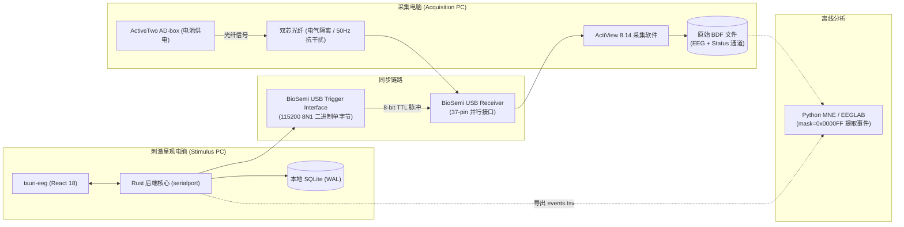

# tauri-eeg

<p align="center">
  <strong>专为认知神经科学与脑机接口（BCI）设计的科研级多模态情绪调控实验桌面系统</strong>
</p>

<p align="center">
  
  
  
  
  
  
</p>

<p align="center">
  <a href="#-核心特性">核心特性</a> •
  <a href="#-系统架构">系统架构</a> •
  <a href="#-快速开始">快速开始</a> •
  <a href="#-硬件打标与事件规范">硬件打标</a> •
  <a href="#-离线数据分析">离线分析</a> •
  <a href="#-项目结构">项目结构</a> •
  <a href="#-文档导航">文档导航</a>
</p>

---

## 🌟 核心特性

- ⚡ **微秒级硬件同步打标**：专为 **BioSemi ActiveTwo** 系统量身定制，Rust 后端独占串口发送 8 位并行 TTL 脉冲，具备 8ms 硬件锁存与 $\ge 12\text{ms}$ 防粘包保护窗口。
- 🎬 **多模态实验范式管理**：标准化情绪诱发视频库（抑郁 / 焦虑 / 恐惧 / 平静），支持自然恢复、音乐调控与视频调控实验闭环。
- 📋 **心理测量全流程自动化**：无缝集成 SAM（情感自评九点量表）、STAI-S（状态焦虑）、state-PANAS 与 GEMS-9，基线/后测自动比对与改善率计算。
- 🧬 **BIDS 规范数据导出**：自动生成符合国际标准的 BIDS 文件命名（`sub-*_ses-*_task-*.bdf`），实验日志一键导出为标准的 `events.tsv` 与 `manifest.json`。
- 🛡️ **数据只读解耦与持久化**：脑电 BDF 生数据只读隔离，实验元数据采用本地嵌入式 **SQLite (WAL 模式)** 存储，保障科研数据真实性与可复现性。

---

## 🏛️ 系统架构

系统采用刺激呈现与脑电采集**物理隔离、时间同步**的经典双机协同拓扑：



---

## 🚀 快速开始

### 依赖环境

| 组件 | 推荐版本 | 说明 |
|---|---|---|
| **Node.js** | $\ge 20.x$ | 前端运行时环境 |
| **pnpm** | $\ge 9.x$ | **必需**，统一的包管理器 |
| **Rust & Cargo** | $\ge 1.80$ (MSVC) | 桌面后端与串口通信编译 |
| **Visual Studio C++ Build Tools** | 2022 | 勾选“使用 C++ 的桌面开发” |
| **Edge WebView2 Runtime** | 最新稳定版 | Windows 界面渲染内核 |

### 安装与运行

```powershell
# 1. 克隆代码仓库并进入根目录
git clone https://github.com/your-org/tauri-eeg.git
cd tauri-eeg

# 2. 安装前端依赖（统一使用 pnpm）
pnpm install

# 3. 启动桌面应用开发模式（含 Rust 核心与串口支持）
pnpm tauri dev
```

> [!TIP]
> **纯前端调试模式**：运行 `pnpm dev` 可在浏览器中预览界面，但无法调用原生硬件串口与本地文件系统扫描。

### 构建与测试

```powershell
# 运行前端单元测试
pnpm test

# 运行 Rust 核心单元测试
cargo test --manifest-path src-tauri/Cargo.toml --lib

# 构建 Windows 安装程序 (.exe / .msi)
pnpm tauri build
```

---

## 🔌 硬件打标与事件规范

### 1. 串口通信配置

- **波特率**：`115200 bps` | **数据位**：`8` | **停止位**：`1` | **校验**：`None` | **流控**：`None`
- **传输格式**：单字节二进制数 `[code]`（值域：$1 \sim 255$）。禁止发送包含换行符的 ASCII 字符串。
- **保护机制**：硬件脉冲宽度为 8ms，后端施加 **$\ge 12\text{ms}$ 安全调度间隔**，避免连续事件粘包。

### 2. 常用核心事件编码速查

完整事件定义参考 [biosemi_events_v1](docs/biosemi-trigger-implementation.md)：

| 码值 (十进制) | 标识符 (`event`) | 说明 |
|:---:|:---|:---|
| **1** | `depression_video_start` | 抑郁诱发视频第一帧有效渲染 |
| **2** | `anxiety_video_start` | 焦虑诱发视频第一帧有效渲染 |
| **5** | `fear_video_start` | 恐惧诱发视频第一帧有效渲染 |
| **10** | `induction_video_end` | 情绪诱发视频播放结束 |
| **31 / 32** | `music_regulation_start / end` | 音乐调控窗口开始 / 结束 |
| **41 / 42** | `video_regulation_start / end` | 视频调控窗口开始 / 结束 |
| **51 / 52** | `natural_recovery_start / end` | 自然恢复静息十字开始 / 结束 |
| **60 / 61** | `run_start / run_end` | 正式实验生命周期起止 |
| **70 / 71** | `pre_scale_start / submit` | 诱发后基线量表开始 / 提交 |
| **72 / 73** | `post_scale_start / submit` | 调控后量表开始 / 提交 |
| **254** | `trigger_test` | 链路连通性硬件测试码 |

---

## 📊 离线数据分析

ActiveTwo 的 `Status` 轨道为 24 位复合通道。在 MNE-Python 中提取低 8 位 Trigger 时，**必须使用 `mask=0x0000FF` 屏蔽高位状态字**：

```python
import mne

# 1. 加载原始 BDF 文件
raw = mne.io.read_raw_bdf("sub-001_ses-01_task-effect.bdf", preload=True)

# 2. 提取事件：必须过滤掩码，仅保留低 8 位 (Bit 0 ~ Bit 7)
events = mne.find_events(
    raw,
    stim_channel="Status",
    mask=0x0000FF,  # 十进制 255
    mask_type="and",
    shortest_event=1,  # 确保 8ms 脉冲在 2048Hz 下被完整捕获
    consecutive=False,
)

print(f"成功提取事件数: {len(events)}")
```

---

## 📁 项目结构

```text
tauri-eeg/
├── src/                        # 前端应用源码 (React + TypeScript)
│   ├── components/             # 通用 UI 组件 (向导、量表、视频播放器)
│   ├── pages/                  # 业务页面 (实验设置、流程执行、记录管理)
│   ├── services/               # 前端服务层 (IPC 桥接、量表计算、状态管理)
│   └── types/                  # 全局 TypeScript 类型定义
├── src-tauri/                  # 桌面后端源码 (Rust)
│   ├── src/                    # 串口控制、SQLite 数据库驱动、IPC 命令处理
│   ├── Cargo.toml              # Rust 依赖声明
│   └── tauri.conf.json         # Tauri 2 配置文件
├── docs/                       # 详细设计与实验 SOP 文档库
├── music-service/              # (可选) 本地 AI 音乐生成微服务
├── video_paradigm/             # 标准化实验视频素材库
└── tests/                      # 单元测试与 E2E 冒烟测试套件
```

---

## 📚 文档导航

深入了解系统设计与实验执行细节，请参阅 `docs/` 目录：

- 📖 [实验标准操作规程 (SOP)](docs/biosemi-operation.md) — 5 步向导使用、电极偏置检查与实验全流程说明。
- ⚡ [硬件打标与串口实现规范](docs/biosemi-trigger-implementation.md) — FTDI 驱动配置、时钟锁存机制与异常恢复。
- 🧪 [实验范式与电生理协议](docs/paradigm-protocol.md) — 诱发-恢复-调控设计、洗脱期及注视十字规范。
- 📊 [心理测量与评估量表规范](docs/scale-instruments.md) — SAM、STAI-S、state-PANAS 量化与评分标准。
- 🎞️ [视频素材库技术要求](docs/video-library-requirements.md) — 编码格式、色彩空间与时长校验规范。

---

## 🛠️ 常见问题排查 (Troubleshooting)

<details>
<summary><strong>1. COM 端口提示“拒绝访问 (Access Denied)”</strong></summary>

- **原因**：端口被多开的 `tauri-eeg` 实例或串口调试软件占用。
- **解决**：打开任务管理器结束所有残留的 `tauri-eeg.exe` 进程，重新插拔触发盒 USB，重启应用后重新连接。
</details>

<details>
<summary><strong>2. ActiView 偏置电压（Offset）大面积报红 (> 50mV)</strong></summary>

- **原因**：CMS 或 DRL 电极接触不良，导致共模反馈回路断开。
- **解决**：**优先重新处理 CMS 与 DRL 电极孔**，补注导电膏并轻柔按摩打圈，确认 `CM in Range` 绿灯常亮后再调节其他通道至绿色区间（$< 20\text{mV}$）。
</details>

<details>
<summary><strong>3. Python 读取 Status 轨道出现 65280 等异常巨额码值</strong></summary>

- **原因**：未屏蔽 Status 轨道的高 16 位状态字。
- **解决**：在 `mne.find_events` 中添加 `mask=0x0000FF`（十六进制掩码）或 `mask=255`。
</details>

<details>
<summary><strong>4. 实验设置向导第 4 步无法点击下一步</strong></summary>

- **原因**：未在 ActiView 中启动 BDF 保存或未手动勾选状态确认框。
- **解决**：生成 BIDS 文件名并在 ActiView 中点击 `Start File` 开始保存，随后勾选“我已在 ActiView 启动本次 BDF 保存”。
</details>

---

## 📄 许可证

本项目基于 [MIT License](https://opensource.org/licenses/MIT) 开源发布。
特别感谢 [BioSemi](https://www.biosemi.com/) 提供的硬件生态支持与 [MNE-Python](https://mne.tools/) 社区。
