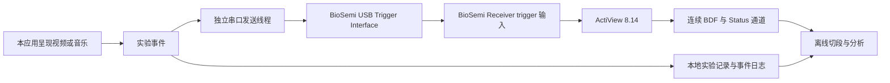

# BioSemi trigger 与离线 BDF 改造实现规格

日期：2026-10-08。状态：软件实现已完成，硬件与 BDF 入标验证尚未完成。

本文根据当前代码、现有范式协议和用户确认的设备整理。用于后续实施与验收。现状、确定需求和建议方案分别标注，建议方案不代表用户已经确认。

## 1. 目标与边界

已确认的需求：

- 设备使用 BioSemi USB Trigger Interface，在 Windows 中显示为 COM 串口。
- 采集软件使用 ActiView 8.14。
- 本应用呈现刺激并发送 trigger。ActiView 采集脑电并保存 BDF，之后离线分析。
- 旧设备的采集逻辑没有适配用户设备，需要移除或替换。
- 保留现有视频调控、音乐调控及实验评价能力。

本文不要求本应用读取实时 BioSemi 数据、生成 BDF、远程控制 ActiView，或实现在线脑电解码。软件实现后的操作步骤见 [BioSemi 实验操作说明](biosemi-operation.md)。

尚未确认的设计选择：

| 项目 | 本文建议 | 实施时处理 |
|---|---|---|
| 打标范围 | 诱发、调控和自然恢复均记录阶段边界 | 实验计划固定后冻结，不能运行中切换 |
| 时间精度 | 首期服务于整段离线分析 | ERP 使用前另做物理刺激时序验证 |
| 中途暂停 | 正式实验默认禁用任意暂停、跳播和切换素材 | 必须操作时记录异常，不当作完整实验 |
| 逐试次入口 | 将个人校准、独立诱发迁到实验范式页 | 保留其流程，不保留旧采集依赖 |
| 模拟反馈 | 从正式实验入口移除，演示功能单独隔离 | 不自动改写为另一种科研范式 |

用户已授权按本文实现。当前软件采用诱发与条件均打标、整段离线分析、运行中固定素材的方案。ERP 精度仍未验证。逐试次类型与旧记录中保留历史反馈定义，但新实验入口仅提供个人校准与独立诱发。

### 1.1 已实现位置

- `src/experiment/api.ts` 与 `settings.ts` 提供独立实验接口和每次运行的外部保存确认。
- `src/pages/home/ExperimentSettings.tsx` 提供串口连接、测试、素材库和模式设置。
- `src/experiment/ExperimentRunHistory.tsx` 提供 BDF 关联与日志导出。
- `src-tauri/src/experiment/` 提供单线程串口输出、实验持久化和事件校验。
- `src/pages/home/useEffectEvaluationFlow.ts` 接入效果评价，播放器首次 `playing` 事件启动条件计时和打标。
- `src/paradigm/paradigmExperiment.ts` 与 `useIndependentParadigmRun.ts` 接入逐试次流程。
- 旧采集页面与前后端设备通信运行代码已删除，旧 `/eeg-acquisition` 路由已移除。

以下第 2 节记录现行范式与实现契约。

## 2. 当前范式设计

### 2.1 效果评价流程

代码入口为 [EffectEvaluation.tsx](../src/pages/home/EffectEvaluation.tsx)，流程控制为 [useEffectEvaluationFlow.ts](../src/pages/home/useEffectEvaluationFlow.ts)，状态与参数为 [effectEvaluationFlow.ts](../src/pages/home/effectEvaluationFlow.ts)。

| 步骤 | 当前行为 | 改造时保留的内容 |
|---|---|---|
| 选择被试 | 配置被试、目标情绪、条件、调控手段和时长 | 被试与实验参数 |
| 情绪诱发 | 按焦虑、抑郁或恐惧选择诱发视频 | 素材与呈现流程 |
| 诱发后量表 | SAM 与 STAI-S、state-PANAS | 题目、评分和原始答案 |
| 条件执行 | 自然恢复，或音乐调控，或视频调控 | 条件类型与时长 |
| 条件后量表 | STAI-S、state-PANAS；音乐调控额外 GEMS-9 | 前后测记录 |
| 结果评价 | 计算改善率并查看历史和跨条件比较 | 结果与导出能力 |

默认调控时长为 5 分钟，可配置为 1–30 分钟。一个流程只执行一个条件。当前跨条件比较使用同被试同情绪的完整记录，不能将一次流程理解为已执行两个条件。

`baseline` 在该流程中表示“诱发后、干预前的量表”，不是逐试次范式中的静息脑电基线。报告与事件日志必须保留这个语义区别。

实验事件从实际刺激边界开始记录，外部 BDF 由 ActiView 保存。正式模式要求触发盒和 BDF 保存确认，排练模式不发送硬件事件。

### 2.2 视频与音乐的实际播放方式

- [EffectFullscreenInduction.tsx](../src/pages/home/EffectFullscreenInduction.tsx) 负责诱发视频，有结束与错误处理，目前没有向流程报告首次实际播放的事件。
- [EffectFullscreenVideoRegulation.tsx](../src/pages/home/EffectFullscreenVideoRegulation.tsx) 从准备按钮启动流程计时，再挂载并播放视频；视频循环播放。
- [EffectRegulationPlayer.tsx](../src/pages/home/EffectRegulationPlayer.tsx) 的音乐分支加载音乐历史，再由操作者选曲并播放。
- [EffectStepPanels.tsx](../src/pages/home/EffectStepPanels.tsx) 当前先启动音乐调控计时，再显示音乐播放器。历史加载和选曲等待会占用调控窗口。
- 独立 [MusicRegulation.tsx](../src/pages/home/MusicRegulation.tsx) 与 [VideoRegulationPlayerModal.tsx](../src/pages/home/VideoRegulationPlayerModal.tsx) 也有播放器。普通素材试听不应自动产生正式实验 trigger。

所以，不能只在现有“开始”按钮旁加入串口发送。必须统一“素材就绪、实际播放、阶段计时、事件记录”的顺序。

### 2.3 逐试次范式

入口为 [ParadigmSessionPanel.tsx](../src/paradigm/ParadigmSessionPanel.tsx)。会话类型、队列和时序分别见 [paradigmSessionKinds.ts](../src/paradigm/paradigmSessionKinds.ts)、[domain.rs](../src-tauri/src/paradigm/domain.rs)、[paradigmTimeline.ts](../src/paradigm/paradigmTimeline.ts)。

| 类型 | 当前队列 | 当前定位 |
|---|---|---|
| `personal_calibration` | 平静类 5 个试次 | 个人校准材料采集 |
| `held_out_generation` | 焦虑、抑郁、恐惧依次成块，每类 5 个试次 | 独立情绪诱发 |

每个类别的视频池至少需要 5 个 MP4。块顺序固定，块内素材按实验编号产生的种子打乱并选取。当前类别为平静、焦虑、抑郁和恐惧。

普通试次时序为：静息基线 5 秒 → 提示 2 秒 → 视频 45–90 秒 → 试后静息 5 秒 → SAM → 质量确认。

视频时长越界会判为 `artifact_rejected`。SAM 与操作者标注产生 accepted、uncertain、rejected 等质量结果。这些结果表示呈现与自评规则，不能代替离线 EEG 伪迹检查。

当前流程没有在线脑电反馈。BDF 只在实验结束后离线分析。

### 2.4 现有采集与 trigger 的限制

| 代码 | 当前作用 | 与 BioSemi 方案的关系 |
|---|---|---|
| 旧 `protocol.rs`，已删除 | 固定 32 通道、自定义网络帧解析 | 不是 BioSemi 协议 |
| 旧 `server.rs`，已删除 | TCP 数据接收与 UDP 启动指令 | 不能用于 COM trigger 输出 |
| 旧 `paradigm_controller.rs`，已删除 | 在内部采集会话中记录试次、软件标记与样本范围 | 已替换为独立实验记录 |
| `src-tauri/src/experiment/` | 实验 run、事件、试次、量表关联和 BDF 导出 | 当前持久化实现 |

事件记录和串口连接状态由 `src-tauri/src/experiment/` 单独负责。

## 3. 改造后的运行方式

操作者先在 ActiView 启动 BDF 保存，再在本应用确认“外部录制已开始”。本应用只保存操作者确认时间，不推断 ActiView 正在保存。

建议一次完整效果评价流程对应一个 BDF。若连续记录多次实验，记录多对 run 开始与结束标记，并用日志中的编号、次序和条件匹配。BDF 文件分卷时允许一个实验关联多个文件。

实验结束后操作者停止 ActiView 保存，补充实际 BDF 文件名或文件列表。本应用不删除、覆盖或搬移原始 BDF。

## 4. 页面与模块边界

将旧“EEG 采集”入口替换为“实验设置”，包含素材库、Trigger 设置与外部记录信息。逐试次运行入口迁到独立的“实验范式”页。

Trigger 设置显示 COM 端口、刷新、连接、断开、测试与最近发送结果。状态文案使用“触发盒已连接”“发送失败”。不显示“BioSemi 已连接并录制”或“BDF 已保存”，除非明确标注为操作者确认。

正式实验与排练分开。正式模式要求触发盒连接、素材就绪和外部保存确认。排练不发硬件 trigger，记录 `rehearsal`，不能在运行中静默降级。

以下文件位置为拟新增位置，实施时可按模块大小拆分，单文件保持在 500 行以内：

| 位置 | 职责 |
|---|---|
| `src/experiment/` | 实验类型、事件定义、前端接口和设置组件 |
| `src/paradigm/` | 当前实验队列、呈现、SAM 与质量标注 |
| `src-tauri/src/trigger/` | 串口配置、连接状态、唯一发送线程、错误处理 |
| `src-tauri/src/experiment/` | 实验、试次、事件持久化及导出 |
| `src/video/` | 素材扫描、校验和库配置；复用现有视频工具 |

先迁移 `useEffectInductionPool`、`useEffectRegulationPool` 依赖的库读取、类型和配置存储。更新 `EffectStepPanels` 中跳转 `/eeg-acquisition` 的入口。

移除波形、环形缓冲、旧 TCP 与 UDP 接收、内部原始 EEG 写入，以及代理启动和停止旧采集的动作。素材管理、试次队列、量表和历史读取不随采集代码一并删除。

原 `eeg-service/` 已删除。`music-service/` 仍用于音乐生成。

## 5. Trigger 输出契约

官方接口使用 115200 波特率、8 数据位、1 停止位、无校验、无流控，接收一个二进制字节并默认维持 8 ms 后归零。接口输出 8 位事件值。详见文末官方资料。

拟采用 Rust `serialport` 库，由专用线程保持 COM 连接。该库支持 Windows、端口枚举及阻塞读写。串口线程不在 UI 或呈现回调中等待。

接口职责为：列出端口、连接、查询状态、测试、断开、接收实验事件。生产入口根据已注册事件推导事件码，不接受任意网页传来的原始命令字节。正式实验中禁止测试和修改串口配置。

发送 `[code]` 一个字节，不发送十进制字符串、换行或 JSON。正常事件不额外发送 0，也不修改触发盒脉冲长度。

一个串口仅由一个线程持有。多个播放器不直接访问端口。后端根据活动 run、事件 ID、素材与阶段核对请求，避免旧页面和异步回调向新实验发送标记。

建议以 12 ms 的最小相邻发送间隔给默认 8 ms 脉冲留出低电平间隙。12 ms 是待硬件验证的工程初值，不是厂商保证。若设备脉冲设置被更改，该值必须重新校验。记录排队等待，不把延迟发送时间伪装为刺激开始时间。

开始 run 的标记发送后再允许启动刺激，避免初始化事件与刺激开始事件挤在同一脉冲窗口。使用有界队列，满队列或日志写入失败均显式报错，不能悄悄丢标。

`written` 只表示操作系统接受了串口写入，不表示 BioSemi 收到或 ActiView 已保存。此接口方案不提供端到端接收确认。

## 6. 建议事件编码表

表名为 `biosemi_events_v1`，属于待冻结的项目编码，不是 BioSemi 预定义事件协议。每个非零码代表一个事件，0 留作空闲。当前情绪码为抑郁 1、焦虑 2、平静 3、恐惧 5。

| 十进制码 | 事件 | 触发时点 |
|---|---|---|
| 1 | depression_video_start | 抑郁诱发首次播放 |
| 2 | anxiety_video_start | 焦虑诱发首次播放 |
| 3 | calm_video_start | 平静校准首次播放 |
| 5 | fear_video_start | 恐惧诱发首次播放 |
| 10 | induction_video_end | 诱发视频正常结束 |
| 20 | baseline_rest_start | 逐试次静息基线开始 |
| 21 | hint_start | 逐试次播放提示开始 |
| 22 | post_rest_start | 逐试次试后静息开始 |
| 23 | baseline_rest_end | 逐试次静息基线结束 |
| 24、25 | reappraisal_start、reappraisal_end | 重评窗口边界，保留码 |
| 31、32 | music_regulation_start、music_regulation_end | 音乐调控窗口边界 |
| 41、42 | video_regulation_start、video_regulation_end | 视频调控窗口边界 |
| 51、52 | natural_recovery_start、natural_recovery_end | 自然恢复窗口边界 |
| 60、61 | run_start、run_end | 正式实验开始与正常结束 |
| 70、71 | pre_scale_start、pre_scale_submit | 诱发后量表打开与保存成功 |
| 72、73 | post_scale_start、post_scale_submit | 条件后量表打开与保存成功 |
| 74、75 | sam_start、sam_submit | 独立试次 SAM 打开与保存成功 |
| 80、81 | media_pause、media_resume | 允许暂停的实验异常或恢复 |
| 82 | media_change | 允许更换素材时记录 |
| 90 | playback_error | 播放故障且串口仍可用 |
| 91 | run_abort | 操作者中止且串口仍可用 |
| 92 | trial_skip | 试次被跳过且串口仍可用 |
| 93、94 | trial_start、trial_end | 独立试次整体边界 |
| 254 | trigger_test | 实验前的连接测试 |

量表标记可在最终实验计划中选择只写软件日志。事件码不承载被试、素材或试次编号；这些字段写入日志。该关联依赖事件次序及完整性，丢标或多标时必须报告匹配不确定，不能继续按次序强行配对。

23–25 只预留，首期关闭模拟反馈正式入口，不发送这些码。普通试听、播放器循环以及 React 重渲染不重复发送阶段开始码。若将来需要逐循环分析，新增独立事件与编码版本，不复用开始码。

## 7. 播放、计时与去重规则

### 7.1 视频

先加载素材并进入准备状态。首次有效播放事件报告 `software_video_onset`，发送对应 trigger，并启动同一阶段的计时。能够检测到首次呈现帧时记录检测来源；后备播放事件必须标注来源差异。

该检测是软件时点，不等于显示器真实亮起。不得承诺首帧与脉冲严格同时，日志保存呈现检测与串口写入两个时间。

诱发正常结束发送 10。调控视频在指定时间到达时停止并发送 42。调控视频循环不再次发送 41。未达到首次有效播放便失败的素材不写开始事件，只记录播放故障与未呈现状态。

### 7.2 音乐

在调控计时前选择曲目，完成文件可用性检查和预加载。首次有效播放报告 `software_audio_onset`，发送 31 并开始调控计时。音频生成、历史查询与选曲等待不计入调控窗口。

到时暂停音频并发送 32。短曲循环不重复发送 31。播放事件不等于耳机实际出声，ERP 精度验证与音频设备延迟另行测量。

正式流程默认固定素材并禁止自由切歌、跳播、倍速和任意暂停。若方案允许暂停，暂停不延长已启动的墙钟窗口，分别记录实际播放与中断时长；这种时长政策须在实验开始前固定。

### 7.3 自然恢复与结束

自然恢复无媒体准备，静息界面进入后发送 51 并计时，到时发送 52。计时使用单调时钟计算经过时长，显示刷新不决定阶段结束。

正常完成后测保存后发送 61，关闭 run。提前结束调控记录原因与实际时长，后测仍可保存，但 run 标为异常，不自动纳入完整条件比较。关闭窗口、重置流程或程序重启时不补发缺失的正常开始或结束事件。

### 7.4 去重与故障

每个事件带唯一 `eventId`，每个阶段带 `phaseInstanceId`。同一次阶段的首次播放只能产生一个开始事件。暂停后的播放是 resume；程序重新挂载不能产生第二个 start。

去重在后端以持久化事件 ID 执行。写串口前保存事件意图，写后更新结果。若程序在写入与结果保存之间崩溃，结果标为 `unknown`，不自动重发。串口与数据库之间无法实现原子提交，不能声称硬件 exactly-once。

正式运行遇到 trigger 故障时停止当前刺激并记录当前段异常，进入中断状态。操作者可在排除故障后开始新的 run。不能自动重连后补发旧开始码；补发会改变离线切段含义。

## 8. 实验记录与旧数据迁移

新增独立的 `experiment_runs`、`experiment_events` 与 `experiment_trials` 表。新试次不再外键关联内部 `eeg_sessions`，不在呈现软件中填写虚构的 EEG 样本索引。

| 记录 | 必需字段 |
|---|---|
| Run | 唯一 runId、userId、subjectId、流程类型、目标情绪、条件、手段、计划时长、素材清单、协议版本、编码版本、正式或排练模式、状态、起止时间 |
| 外部录制关联 | ActiView 版本、操作者保存确认时间、预期记录名、实际 BDF 文件列表、关联状态 |
| Event | eventId、runId、顺序号、trialId、phaseInstanceId、事件名、事件码、素材 ID、软件时点及来源、后端接收时间、串口写入起止时间、结果与错误原因 |
| Trial | 队列位置、情绪、素材、呈现状态、起止事件 ID、SAM、质量标注与原因 |
| 量表关联 | runId、量表记录 ID、测量时点与条件 |

时间日志同时记录 UTC 墙钟时间与相对当前 run 的单调时间。前端单调时钟和 Rust 时钟原点不同，保存各自来源，不直接相减。后端计算排队时间，前端计算播放窗时长。离线脑电时间轴以 BDF 样本为准。

事件结果至少区分排练未发送、等待发送、串口写入成功、失败和未知。未知与失败影响 run 完整性。数据写入到应用管理目录，导出 `manifest.json`、`events.tsv` 与试次表，清单包含全部编码定义和实际 BDF 关联信息。

不再实现旧 `eeg_sessions`、`eeg_trials` 读取或写入，也不提供旧量表字段兼容。新的量表记录必须关联当前实验 run。

新报告使用同一 run 的前测与后测配对。旧记录继续按原有语义显示，不能根据时间临近就伪造 run 关联。跨条件自动比较保持现有策略，但过滤中止、排练和不完整记录，并显示实际比较的两个 runId。

只依据软件日志可判断播放、计时和发送完整性。没有检查 BDF 时不能声称脑电完整或无伪迹。

## 9. 实施顺序与完成条件

### 9.1 迁移素材与范式

迁出素材扫描、库配置、类型、队列、呈现和 SAM。更新所有旧采集页跳转。将 `beginEegTrial`、`markEegTrial`、`endEegTrial` 替换为独立实验生命周期。

完成条件：不启动旧 EEG 服务也能在排练中完成效果评价，以及个人校准与独立诱发；旧素材路径可读取，所有旧排程与时序仍一致。

### 9.2 实现独立串口输出

添加 Rust 串口依赖、发送线程和边界校验。完成 COM 设置与测试页，创建事件清单与发送结果持久化。

完成条件：端口被占用、拔出、重复事件和队列故障均可观察；测试发送实际写入单个字节；正式模式不接受任意测试码。

### 9.3 接入播放与计时

修改诱发播放器、全屏视频调控和音乐播放器，增加准备态和首次播放事件。统一由活动 run 的事件入口处理，普通素材试听不发实验码。

完成条件：音乐等待不计时；视频与音乐各只发一次阶段开始码；到时停止；暂停、循环、失败和重挂载不重复开始。

### 9.4 关联量表与外部文件

新增实验记录表与量表 run 关联。更新结果、历史、报告和导出。实施可重复的增量数据库迁移，不改写已有记录含义。

完成条件：当前 run 可读取、导出完整事件与量表清单，BDF 缺失或尚未关联明确可见。

### 9.5 删除旧采集依赖

移除实时采集页面、旧设备通信、波形渲染、内部录制入口、旧实验服务和相应代理动作。清理注册命令、启动脚本、依赖与无效测试。

完成条件：正式实验与素材管理不依赖旧采集上下文；没有遗留入口引导到已删除页面；音乐生成服务和既有量表计算仍可用。

### 9.6 验证与硬件验收

运行项目构建与现有测试。新增行为测试覆盖事件码、重复回调、错误发送、音乐准备、正常结束与异常中止、旧数据库迁移和报告配对。Rust 发送逻辑测试使用可注入字节写入器，不能仅断言“调用过发送函数”。

硬件验收由实际设备完成：

1. 在 ActiView 开始保存短 BDF，发送 1、2、4、8、16、32、64、128 的测试字节。
2. 检查 BDF Status 的低 8 位事件值和归零间隔。高位含其他触发及状态信息，不将整个 Status 值当作本项目事件码。
3. 在短测试序列中覆盖全部正式事件码，核对码值、数量、次序和日志，排除丢标、多标与相邻脉冲合并。
4. 完成一次视频调控和一次音乐调控；若保留自然恢复比较，再完成一次自然恢复。确认 BDF 切段与事件清单对应。
5. 测试拔掉触发盒、播放失败、提前结束和重启，确认异常结果不显示为正常完成，不重放旧 trigger。
6. 保存实际延迟测量、设备与音频配置、脉冲设置和验收结果。

软件测试不能代替硬件验收。本应用没有 BDF 回读能力时，用离线工具检查文件并保留核对记录。

ERP 使用前，以光电或音频检测测量刺激实际呈现与 trigger 的偏差及抖动，按最终科研方案定义可接受阈值。仅靠 `playing` 回调或串口写入成功不足以通过 ERP 验收。

## 10. 资料与证据

- [现有范式协议](paradigm-protocol.md)：流程、时长、量表与文献依据。它包含实时反馈规划，不能把规划当作已实现硬件能力。
- [量表设计](scale-instruments.md)：量表测量时点和评分口径。
- [BioSemi USB Trigger Interface 官方说明](https://www.biosemi.com/faq/USB%20Trigger%20interface%20cable.htm)：串口设置、二进制字节、8 位输出与默认脉冲。
- [BioSemi trigger 与 Status 官方说明](https://www.biosemi.com/faq/trigger_signals.htm)：Status 记录与物理刺激时序验证。
- [serialport-rs 官方仓库](https://github.com/serialport/serialport-rs)：Windows 串口与阻塞读写。已通过 Context7 核对配置；实施时固定实际采用版本。

当前 BioSemi 具体型号、实际采样率和 COM 编号尚未给出。不要继承旧后端的 32 通道与 1000 Hz 为 BioSemi 参数；这些信息由真实 BDF 和采集配置提供。
